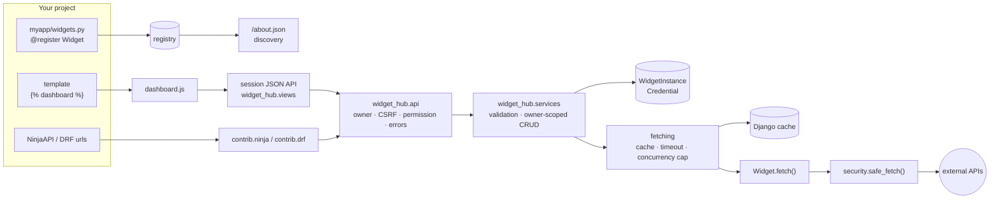

# django-widget-hub

Declare a dashboard widget once in Python, and get parameter validation, caching, owner-scoped
CRUD, an `/about.json` discovery endpoint, django-ninja and DRF adapters, and a ready-made front.

```python
# settings.py: INSTALLED_APPS += ["widget_hub"]   urls.py: path("", include("widget_hub.urls"))
from widget_hub import Service, Widget, params, register


@register
class CityWeather(Widget):
    service = Service("weather")
    name = "city_weather"
    params = [params.String("city", max_length=100)]

    def fetch(self, params, context):
        return {"city": params["city"], "temperature": 21}


# template: 
```


## Why this exists

This package comes out of the Epitech *Dashboard* project, a Django + React app where users place
widgets (weather, RSS, GitHub, Steam…) on a grid and the grading script reads `/about.json`. In
that codebase, adding **one** widget meant editing three or four places that nothing kept in sync:

1. `services/registry.py`: a hand-written dict that `/about.json` returns as-is;
2. `services/api.py`: a dedicated route that calls the external API and shapes the response;
3. `WidgetInstance.params`: a free-form JSON field, "not yet validated against the registry";
4. the React component that knows the route, the params and the response shape.

**Before**, for the RSS widget (abridged from the original code):

```python
# services/registry.py
{
    "name": "rss",
    "widgets": [
        {
            "name": "article_list",
            "description": "Display the latest articles of an RSS feed",
            "params": [{"name": "link", "type": "string"}, {"name": "number", "type": "integer"}],
        }
    ],
}


# services/api.py
@api.get("/rss")
def rss(request, link: str, number: int = 5):
    if not 1 <= number <= 20:
        return api.create_response(
            request, {"error": "number must be between 1 and 20"}, status=400
        )
    try:
        url = link
        for _ in range(4):  # hand-made SSRF check + redirect loop
            if not _is_public_url(url):
                ...
            response = requests.get(url, timeout=10, allow_redirects=False)
            ...
    except (requests.RequestException, ValueError) as error:
        return api.create_response(request, {"error": "...", "details": str(error)}, status=503)
```

**After**, the whole widget:

```python
@register
class ArticleList(Widget):
    service = rss
    name = "article_list"
    description = "Display the latest articles of an RSS feed"
    params = [params.Url("link"), params.Integer("number", min_value=1, max_value=20, default=5)]

    def fetch(self, params, context):
        return parse_feed(safe_fetch(params["link"]).content, params["number"])
```

`/about.json`, validation, the route, owner scoping, caching, error handling and the settings form
all derive from that declaration. The scattered version caused real bugs:

- two registry entries were both named `"weather"`, so the grader would count one service and
  **a widget was hidden**; it was only caught by reading the output (project changelog);
- the registry said `"naza_picture"` while the route was `/nasa_picture`: a typo nothing could
  detect, since the registry and the routes are unrelated code;
- stored params were never validated, so a widget could be saved with values its route rejected;
- error responses carried `str(exception)` to the browser, leaking upstream URLs and library
  messages;
- the SSRF check resolved the host, then `requests` resolved it **again** (DNS rebinding window),
  and `client.host` trusted a client-supplied `X-Forwarded-For`;
- the token encryption key was `sha256(SECRET_KEY)`: rotating `SECRET_KEY` silently destroyed
  every stored token;
- the `clock` widget was declared in the registry with no backend route at all: nothing checks
  that a declared widget can actually be served.

## Existing solutions

Researched on PyPI and GitHub on 2026-10-15 (details and method in
[docs/research.md](docs/research.md)).

| Package | What it does | Why it does not fit |
|---|---|---|
| [django-dashing](https://github.com/talpor/django-dashing) | Dashing-style dashboard, JS widgets fed by Django views | one shared dashboard defined in JS; no per-user instances or typed params; last release 2019 |
| [django-controlcenter](https://github.com/byashimov/django-controlcenter) | admin dashboards from widget classes over querysets | staff-facing, code-defined pages; users cannot add or configure instances |
| [django-admin-tools](https://github.com/django-admin-tools/django-admin-tools) | customisable admin index dashboard and menu | admin only; modules are layout blocks, not parameterised data widgets |
| [django-jet](https://github.com/geex-arts/django-jet) | admin theme with dashboard modules | admin theme; last PyPI release 2018 |
| [django-plotly-dash](https://github.com/GibbsConsulting/django-plotly-dash) | embeds Plotly Dash apps in templates | brings the Dash stack; solves interactive charts, not a widget catalogue |
| [django-dash](https://github.com/barseghyanartur/django-dash) | per-user dashboards with plugin widgets | closest idea, but form/template based, no JSON API or discovery endpoint; no current Django classifier, last push 2022 |
| [django-dashboards (wildfish)](https://github.com/wildfish/django-dashboards) | declarative data dashboards | repository archived |
| [django-admin-charts](https://github.com/PetrDlouhy/django-admin-charts) | charts over model data in the admin | model statistics for staff, not external-API widgets for users |
| [Wagtail admin panels](https://docs.wagtail.org/en/stable/extending/customising_admin_templates.html) | `construct_homepage_panels` hook | requires Wagtail; editor-facing HTML panels |
| [django-dashboard-app](https://github.com/bitmazk/django-dashboard-app) | grid of widget plugins polling endpoints | unmaintained since 2014, shared dashboard |

None offers "declare once → validation + owner-scoped CRUD + caching + discovery endpoint + REST
adapters". Whether some of them could be bent to it with custom code was not evaluated.

## Features

- **Declarative widgets**: `Service`, `Widget`, typed params, `@register`; duplicate names stop
  the server at startup.
- **Validation** of every parameter (type, required, bounds, choices, URL shape) with one precise
  message per field, before `fetch()` runs.
- **Storage**: a `WidgetInstance` model on `AUTH_USER_MODEL`, migrations and admin included.
- **Owner scoping** everywhere: another user's instance is a 404.
- **Caching and limits**: Django cache per (widget, params), min/max refresh rate, per-call
  timeout, cap on concurrent upstream calls.
- **One error contract** across all endpoints; exception details stay in logs.
- **`/about.json`** in the Epitech format, generated from the registry.
- **Adapters** for django-ninja and DRF, plus a session JSON API for the built-in front.
- **Security helpers**: `safe_fetch()` (SSRF-safe HTTP) and an encrypted credential store.
- **Built-in front**: `` with drag/resize, generated settings forms, keyboard
  support, light/dark themes, no build step.

## Installation

```bash
pip install django-widget-hub            # core
pip install "django-widget-hub[ninja]"   # + django-ninja adapter
pip install "django-widget-hub[drf]"     # + Django REST framework adapter
```

Supports Django 5.2 LTS, 6.0 and 6.1, with the Python versions each supports (3.10–3.14 for 5.2,
3.12–3.14 for 6.x).

```python
INSTALLED_APPS = [..., "widget_hub"]
# urls.py
urlpatterns = [..., path("", include("widget_hub.urls"))]
```

Then `python manage.py migrate`. Put widgets in `<your_app>/widgets.py`: those modules are
imported automatically at startup.

| Dependency | Why |
|---|---|
| Django ≥ 5.2 | the framework this app plugs into |
| cryptography ≥ 42 | Fernet + HKDF for the credential store; the standard library has no authenticated encryption |
| django-ninja (extra `ninja`) | only for the ninja adapter |
| djangorestframework (extra `drf`) | only for the DRF adapter |

HTTP (`safe_fetch`), caching, threading and validation use the standard library and Django.

## Configuration

All settings live in one optional dict, `WIDGET_HUB = {...}`. Unknown keys and bad values fail
`manage.py check` (`widget_hub.E001`–`E006`).

| Key | Default | Meaning |
|---|---|---|
| `CACHE_ALIAS` | `"default"` | alias in `CACHES` used for `fetch()` results |
| `CACHE_PREFIX` | `"widget_hub"` | prefix of every cache key |
| `MIN_REFRESH_RATE` | `30` | smallest refresh rate (seconds) a user may choose |
| `MAX_REFRESH_RATE` | `86400` | largest refresh rate (seconds) |
| `FETCH_TIMEOUT` | `10.0` | seconds one `fetch()` may run |
| `MAX_CONCURRENT_FETCHES` | `32` | running `fetch()` calls (and DNS lookups) per process, timed-out ones included |
| `ABOUT_TRUST_X_FORWARDED_FOR` | `False` | take `/about.json` `client.host` from `X-Forwarded-For` (only behind a proxy that sets it) |
| `OWNER_RESOLVER` | `"widget_hub.auth.default_owner"` | `request -> user or None` (dotted path or callable) |
| `PERMISSION_CHECK` | `None` | `(request, owner, action) -> bool`; `None` allows everything |
| `POSITION_VALIDATOR` | `"widget_hub.services.clean_position"` | `value -> dict` raising `ValueError(message)`; the default accepts the built-in front's grid `{x, y, w, h}`, swap it for a front with another layout model (e.g. pixels) |
| `CREDENTIALS_KEY` | `None` | secret, or `[new, old, ...]` for rotation; `None` derives from `SECRET_KEY` (warning `W001`) |
| `SAFE_FETCH_TIMEOUT` | `5.0` | `safe_fetch()` overall deadline, seconds |
| `SAFE_FETCH_MAX_BYTES` | `2097152` | largest body `safe_fetch()` accepts |
| `SAFE_FETCH_MAX_REDIRECTS` | `3` | redirects `safe_fetch()` follows, each one re-validated |

The default owner is `request.auth` when an API framework set it to a user, else `request.user`.
`action` is one of `catalog`, `list`, `create`, `retrieve`, `update`, `delete`, `fetch`,
`credentials`.

## Declaring widgets

```python
# myapp/widgets.py
from widget_hub import Service, Widget, WidgetError, params, register
from widget_hub.security import safe_fetch

weather = Service("weather", description="Open-Meteo forecasts")


@register
class CityForecast(Widget):
    service = weather  # required; reuse the same Service object per service
    name = "city_forecast"  # required; unique within the service
    description = "Daily forecast for a city"
    default_refresh_rate = 600  # seconds, kept within MIN/MAX_REFRESH_RATE
    params = [
        params.String("city", max_length=100),
        params.Integer("days", min_value=1, max_value=16, default=5),
    ]

    def fetch(self, params, context):
        # params: validated values, defaults applied. context: FetchContext(owner, instance_id,
        # credential). Return anything JSON-serialisable.
        response = safe_fetch("https://api.example.com/forecast", params=params)
        if response.status == 404:
            raise WidgetError("City not found.", 404)
        return response.json()
```

Two widgets with the same service and name, or two `Service` objects with the same name, stop
the server with an `ImproperlyConfigured` error naming both declarations. Other class attributes:
`cache_per_owner` (results depend on the user) and `uses_credential` (see Security).

## Params reference

| Param | Options | Accepts | `/about.json` type |
|---|---|---|---|
| `String(name, min_length=, max_length=)` | | strings, stripped | `string` |
| `Integer(name, min_value=, max_value=)` | | ints and decimal strings (`"42"`); not booleans or floats | `integer` |
| `Boolean(name)` | | `true/false`, `"1"/"0"`, `"yes"/"no"`, `"on"/"off"` | `boolean` |
| `Choice(name, choices=[...])` | | one of the listed strings | `string` |
| `Url(name, schemes=("http", "https"))` | `max_length` defaults to 2048 | absolute URL with a host, no credentials | `string` |

Every param also takes `required=True`, `default=`, `label=`, `help_text=`; defaults are
validated when the class is defined. `Widget.validate(data)` returns the cleaned dict or raises
`ParamValidationError` whose `errors` maps each parameter (or `"__all__"`) to one message, e.g.
`{"days": "Must be less than or equal to 16.", "colour": "Unknown parameter."}`.
`Widget.schema()` is the JSON description used by the front and API clients.

## Caching and rate limits

`fetch()` results go through Django's cache framework (`CACHE_ALIAS`; Django's default backend is
LocMem, use Redis or Memcached to share it between processes). The key is `(service, widget,
normalised params)`, so a hundred users showing the weather in Paris cause one upstream call per
refresh period; set `cache_per_owner = True` when the data depends on the user. An entry is reused
while it is younger than the instance's `refresh_rate`, which must stay within
`MIN_REFRESH_RATE`–`MAX_REFRESH_RATE`: calling the data endpoint in a loop never reaches the
external API more than once per period, failures included.

Simultaneous misses on the same key are coalesced: the first request calls `fetch()`, the others
wait for its result (20 identical requests at the same instant → 1 upstream call, measured).

Each `fetch()` runs in a shared worker pool and is abandoned after `FETCH_TIMEOUT`; at most
`MAX_CONCURRENT_FETCHES` run at once (abandoned ones count until they return), beyond that the
call gets a 503 immediately. A cache hit costs about 20 µs, the worker hop about 50 µs.

## Error contract

Inside `fetch()`, raise `WidgetError(message, status=502)` for expected failures; the message is
shown to the user as is. Any other exception, a timeout or a non-JSON result becomes a 503 with a
generic message, and the traceback goes to the `widget_hub` logger only.

```json
{"error": {"code": "invalid_input", "message": "Invalid input.",
           "details": {"params": {"days": "Must be less than or equal to 16."}}}}
```

| code | status | when |
|---|---|---|
| `invalid_input` | 400 | payload failed validation; `details` maps field → message (`details.params` per parameter) |
| `not_authenticated` | 401 | no authenticated user |
| `permission_denied` | 403 | the permission check refused, or CSRF failed |
| `not_found` | 404 | unknown widget, or instance missing / owned by someone else |
| `widget_error` | from `WidgetError` | `fetch()` raised `WidgetError` |
| `unavailable` | 503 | `fetch()` crashed, timed out, or the concurrency cap was reached |

`details` only appears for `invalid_input`.

## Using the adapters

All adapters expose the same routes, payloads and errors (they call `widget_hub.api`):

| Method | Path | Result |
|---|---|---|
| GET | `catalog` | every widget's schema |
| GET | `instances` | the user's instances |
| POST | `instances` | create (`service`, `widget`, `params`, `refresh_rate`, `position`) → 201 |
| GET | `instances/{id}` | one instance (404 if it is someone else's) |
| PATCH | `instances/{id}` | update `params`, `refresh_rate`, `position` |
| DELETE | `instances/{id}` | 204 |
| GET | `instances/{id}/data` | `{"data": ..., "fetched_at": "...", "cached": bool}` |
| GET | `credentials` | services the user stored a secret for (never the secret) |
| PUT | `credentials/{service}` | store `{"secret": "..."}` encrypted → 204 |
| DELETE | `credentials/{service}` | 204 |

**django-ninja** (`pip install "django-widget-hub[ninja]"`):

```python
from ninja import NinjaAPI
from widget_hub.contrib.ninja import build_router

api = NinjaAPI(auth=...)  # the router inherits your authenticators
api.add_router("/widgets", build_router())
```

**DRF** (`pip install "django-widget-hub[drf]"`):

```python
from widget_hub.contrib.drf import build_router

urlpatterns = [path("api/widgets/", include(build_router().urls))]  # trailing_slash=False
```

Bodies are JSON parsed by widget_hub (not pydantic or serializers) so errors stay identical.
Ninja and DRF answer with their own bodies when *their* authenticators reject a request.

## The built-in front

```django


```

The tag renders the logged-in user's dashboard through the session API in `widget_hub.urls`: a
12-column grid, drag to move (⠿ handle) or resize (corner), and the keyboard equivalent (focus the
handle; arrow keys move, Shift + arrows resize, announced to screen readers). "Add widget" and ⚙
open a form generated from the param schema, with server errors next to each field and a password
field for widgets using a credential. Each widget refreshes at its own rate, timers pause while the
tab is hidden, and a failing widget shows its error in its own frame, keeps its last data and
retries at the next refresh without affecting the others. Placements that would overlap are
refused.

Data is rendered generically through `textContent` (objects as definition lists, arrays as lists,
http(s) URLs as links or images). Custom rendering per widget:

```js
WidgetHub.registerRenderer("weather.city_forecast", (element, data) => {
  element.textContent = `${data.temperature} °C`;
});
```

No secret is written in the page (only API URLs, refresh limits and Django's CSRF field). Themes
follow `prefers-color-scheme`; force one with `data-theme="light|dark"` on `.wh-dashboard` or
override the `--wh-*` CSS custom properties.

## Security

**Owner scoping.** Every instance and credential operation takes the owner explicitly; another
user's instance answers 404, exactly like a missing one.

**CSRF.** Unsafe requests must pass Django's CSRF check unless an API authenticator accepted the
request *and* no session cookie was sent (token clients).

**Validation before `fetch()`.** Params are validated on create/update and again before every
`fetch()`, so a changed declaration never feeds stale input to a widget.

**SSRF: `safe_fetch()`.** Use it whenever a URL comes from a user:

```python
from widget_hub.security import safe_fetch

response = safe_fetch(params["feed"], timeout=5, max_bytes=1_000_000)
items = parse(response.text)  # .status, .headers, .content, .text, .json()
```

It accepts only `http`/`https` URLs without embedded credentials; resolves the host (within the
deadline) and refuses it if *any* address is private, loopback, link-local (cloud metadata),
CGNAT, multicast or reserved, including IPv4 embedded in IPv6 (mapped, NAT64, 6to4, Teredo); then
connects to the address it checked, keeping the host name for `Host`, SNI and certificate checks,
so DNS rebinding cannot swap the target. Redirects are followed by hand and re-validated, and the
headers you pass are dropped as soon as a redirect changes scheme, host or port. The deadline is
absolute (a watchdog closes the socket even if the server trickles bytes) and bodies are
size-limited. Failures raise `SafeFetchError`, a `WidgetError` with a safe message (400 refused,
502 network error, 504 timeout).

**Credentials.** A widget that needs a user's token sets `uses_credential = True` (which requires
`cache_per_owner = True`, enforced at startup) and reads `context.credential`: the owner's secret
for that widget's service only, or `None`. Users store it with `PUT credentials/{service}` or in
the front's settings form. Secrets are encrypted with Fernet under a key derived with HKDF-SHA256
from `CREDENTIALS_KEY` (or `SECRET_KEY`, with `SECRET_KEY_FALLBACKS` still decrypting after a
rotation). They never appear in responses, `repr()`, logs or the admin.

**Errors** never include exception details (see the error contract).

## The `/about.json` endpoint

`include("widget_hub.urls")` publishes a public `GET /about.json` in the Epitech Dashboard
format, generated from the registry so it cannot disagree with the widgets that exist:

```json
{"client": {"host": "10.0.0.7"},
 "server": {"current_time": 1760000000,
            "services": [{"name": "weather",
                          "widgets": [{"name": "city_forecast",
                                       "description": "Daily forecast for a city",
                                       "params": [{"name": "city", "type": "string"},
                                                  {"name": "days", "type": "integer"}]}]}]}}
```

`client.host` is `REMOTE_ADDR` unless `ABOUT_TRUST_X_FORWARDED_FOR` is set (do it only behind a
reverse proxy that overwrites the header).

## Architecture



## Design decisions

Every non-obvious choice is written up as problem → options → choice → why → impact in
[docs/decisions.md](docs/decisions.md). In short:

- params are an explicit list, not class attributes (order, no name clashes) — D4;
- duplicate names are startup errors — D5;
- one framework-agnostic service layer under thin adapters — D6, D11;
- shared cache by default, `cache_per_owner` opt-in, required for credentials — D7, D13;
- `fetch()` timeout via worker threads, capped — D8;
- one error contract, details only in logs — D9;
- `safe_fetch()` on the standard library with connection pinning — D12;
- a vanilla JS front with no build step — D14.

## Real-world proof

The Epitech dashboard's widget layer (6 services, 8 widgets, commit `e56b817`) was migrated to
the plugin in [`integration/epitech/`](integration/epitech): the hand-written registry, the
widget routes and the `WidgetInstance`/`ServiceCredential` models were replaced, existing rows are
moved by a tested data migration, and **`/about.json` is byte-for-byte identical** to the one
captured from the original backend running, directly and behind the proxy.

| | Before | After |
|---|---|---|
| Files touched to add one widget | 4 (registry, route, front config, component) | 1 (`widgets.py`) |
| Widget-related lines of code | 495 | 253 (−49 %) |
| Duplicate names, registry/route mismatch, widget without backend | possible, each happened | impossible (startup error or same declaration) |
| Param bounds | re-coded per route, stored params never checked | declared once, checked on save and before `fetch()` |
| Errors / SSRF / token key | `str(exception)` sent; host resolved twice; `sha256(SECRET_KEY)` | one contract; pinned `safe_fetch`; HKDF key with rotation |

The migration also improved the plugin: the React front stores pixel positions, which led to the
`POSITION_VALIDATOR` setting. Full write-up, method and limits (the React front itself was not
migrated): [docs/migration-epitech.md](docs/migration-epitech.md).

## Limitations and roadmap

- Timed-out `fetch()` calls cannot be killed (Python threads); they are capped and abandoned.
- Simultaneous misses are coalesced within one process only; several processes missing the same
  key at the same instant each call the upstream once.
- `safe_fetch()` is GET-only, without connection pooling or automatic decompression.
- The built-in front has no collision resolution (overlapping moves are refused, not reflowed)
  and renders data generically unless you register a renderer.
- Not yet: per-user rate limits beyond the refresh rate, async (`async def fetch`) widgets,
  translations of the front's strings.

## Contributing

See [CONTRIBUTING.md](CONTRIBUTING.md). Run `pytest`, `node --test "tests/js/*.test.js"` and
`ruff check . && ruff format --check .` before opening a pull request. The changelog is in
[CHANGELOG.md](CHANGELOG.md).

### Example project

`example/` runs three widgets (`example/demo_widgets/widgets.py`): `weather.current` (public API),
`rss.latest` (user URL through `safe_fetch`; try `http://169.254.169.254/`) and
`github.my_repositories` (stored token).

```bash
pip install -e ".[dev]"
cd example && python manage.py migrate && python manage.py createsuperuser
python manage.py runserver      # log in at /admin/, then open /
```

## License

MIT, see [LICENSE](LICENSE).
